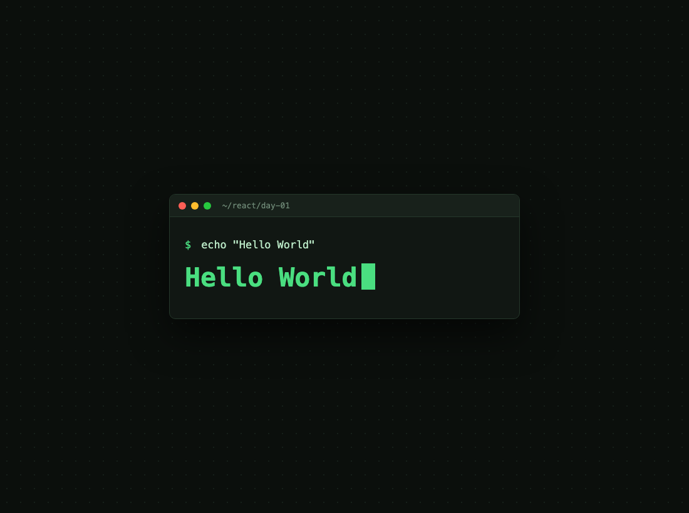

# Day 01: Hello World

**UI:** a green-on-black terminal window printing `echo "Hello World"` with a blinking cursor.

## What I learned
- **Vite + React setup.** `npm create vite@latest` creates the project. `npm run dev` starts the dev server with hot reload.
- **Entry point.** `main.jsx` calls `createRoot(document.getElementById('root')).render(<App />)`. That is how React attaches to the page.
- **Components are functions.** `App` is a function that returns JSX, and the component name starts with a capital letter.
- **JSX is not HTML.**
  - Use `className` instead of `class`.
  - Every tag must be closed, for example `<i></i>`.
  - A component must return one parent element, or a fragment `<>...</>`.
- **Styling.** Plain CSS imported in `main.jsx`.
