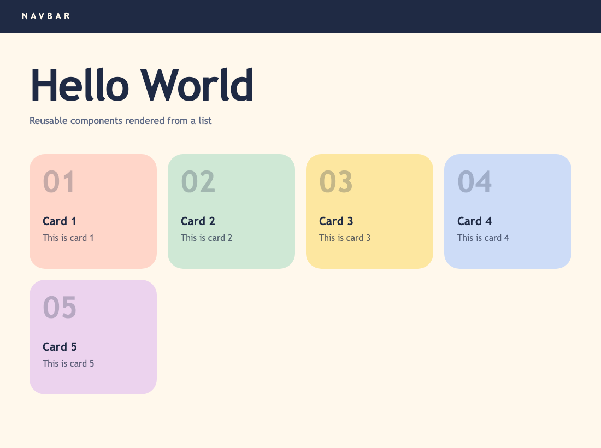

# Day 02: Components, props and lists

**UI:** pastel rounded cards on a cream background, with a navy navbar on top.

## What I learned
- **Splitting the UI into components.** `NavBar` and `CardComponent` live in `src/Components/` and are imported into `App`.
- **Props.** Data goes from parent to child as attributes: `<CardComponent title={...} description={...} />`. The child reads them from `props.title`.
- **Props are read-only.** A child never changes its props. Data flows one way, downwards.
- **`props.children`.** Whatever sits between a component's opening and closing tags arrives as `props.children`.
- **Rendering lists with `.map()`.** An array of objects becomes an array of components.
- **`key`.** Each item in a list needs a unique, stable `key` (here, `item.id`). React uses it to track items between renders. The array index is a poor key when the list can change.
- **`{}` in JSX.** Curly braces run any JavaScript expression inside the markup.
