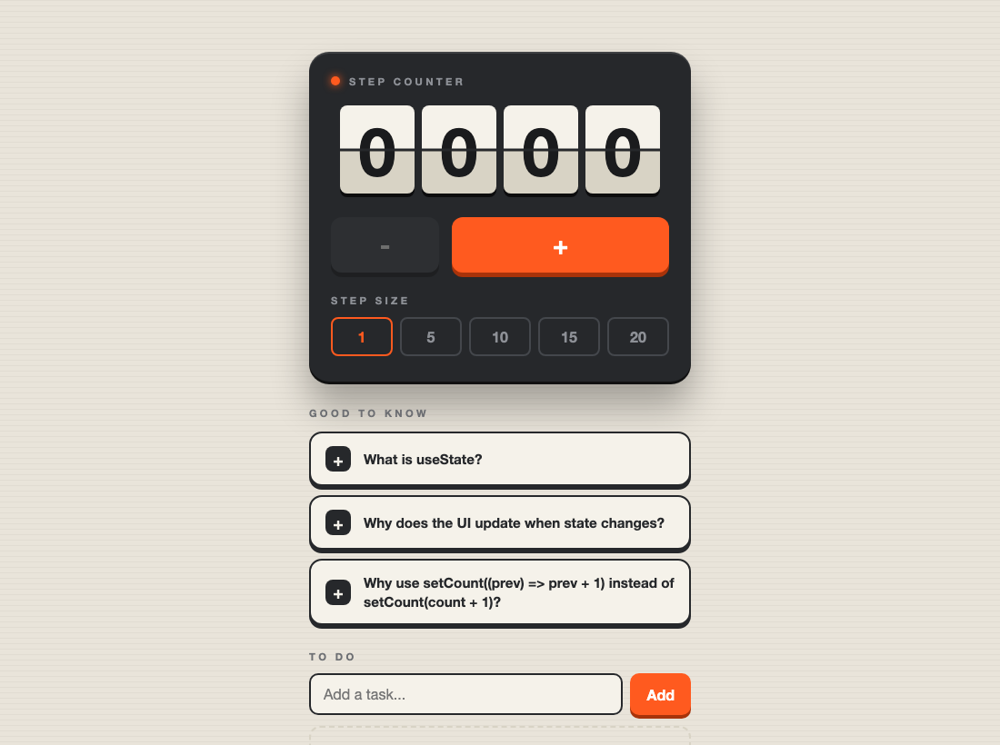

# Day 03 practice: step counter, FAQ and todo

**UI:** a step counter with flip-clock digits and step-size chips, an FAQ accordion, and a todo list.

## What I learned
- **Several pieces of state in one component.** `Counter` holds both `stepCount` and `stepIncrease`.
- **Guarding state updates.** The decrement button returns `0` instead of going negative. It's also `disabled` when the count is 0.
- **Rendering from an array.** `allowedSteps.map(...)` creates the chips, and `isActive` highlights the selected one.
- **Accordion (only one open at a time).** The state is an array of FAQs. A click does `map` that flips the clicked item and sets every other item to `isEnabled: false`.
- **Accessibility.** `aria-expanded` on the question button, and `aria-label` on icon-only buttons.
- **Empty state.** `todos.length === 0 ? 
List Empty
 : <ul>...</ul>`.
- **Derived state.** `completedTasks` is computed with `.filter()` during render.
- **Conditional button.** "Clear Completed" only shows when `completedTasks > 0`.
- **Immutable updates again.** `map` to toggle, `filter` to delete and to clear completed.
