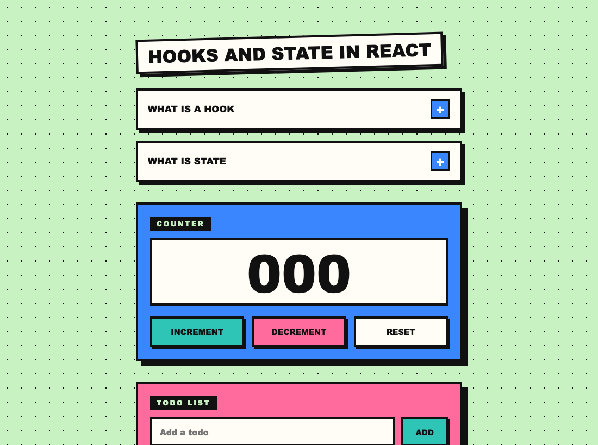

# Day 03: Hooks and `useState`

**UI:** a neo-brutalist poster. It has a yellow dotted background, thick black outlines and hard offset shadows. It contains expandable "What is a hook / state" panels, a counter and a todo list.

## What I learned
- **A hook** is a function whose name starts with `use`. Call hooks at the top level of a component, never inside loops or `if` blocks.
- **Why a plain variable doesn't work.** Changing `let count` doesn't tell React anything, so the screen never updates.
- **`useState`.** `const [count, setCount] = useState(0)` gives the current value and a setter. Calling the setter makes React re-render the component.
- **Functional updates.** `setCount((c) => c + 1)` always receives the latest value, so it stays correct when updates are queued together.
- **Toggle component.** Boolean state drives conditional rendering: `{isOpen && 
...
}`.
- **Todo app: the three immutable update patterns.**
  - Add: `[...prev, newItem]`
  - Update one item: `prev.map(t => t.id === id ? { ...t, isComplete: !t.isComplete } : t)`
  - Delete: `prev.filter(t => t.id !== id)`
  - Never mutate state directly.
- **Controlled inputs.** `<input value={text} onChange={(e) => setText(e.target.value)} />`, with the text kept in state.
- **Forms.** Use `onSubmit` with `e.preventDefault()`, then trim and validate the text.
- **Lifting state up.** `TodoApp` owns the todos, and `TodoItem` and `TodoForm` call functions passed down as props (`onAdd`, `onToggle`, `onDelete`).
- **Derived values.** "2 of 4 done" is calculated from `todos` each render and isn't stored in state.
