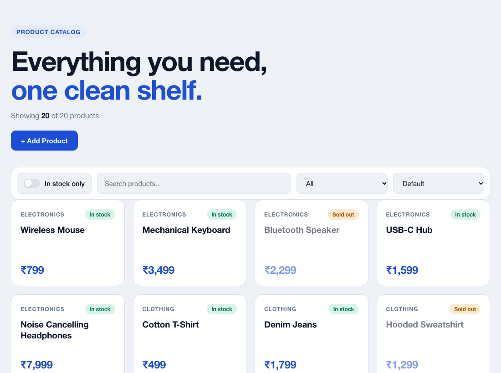

# Day 04 practice: Product catalog

**UI:** a clean Swiss-style storefront with a cool grey page, white cards and cobalt blue accents. It has a toggle for in-stock items, search, category and sort controls, and an Add Product popup.

## What I learned
- **Data module.** 20 products in `data/products.js`, each with `id`, `name`, `category`, `price` and `inStock`.
  - It's a `.js` file because JSON can't call `crypto.randomUUID()`.
- **Lookup objects instead of long `if` chains.**
  - `SORTING_ORDER` maps a key to a label for the dropdown.
  - `SORT_FUNCTIONS` maps the same key to a compare function.
  - A new sort needs one entry in each, and the `<select>` builds its options with `Object.entries(...)`.
- **Never mutate state when sorting.** `[...products].sort(...)` copies first, because `.sort()` changes the array it's called on.
- **Derived state.** `visibleProducts` is computed on every render from `products`, `query`, `category`, `order` and `isInStockEnabled`. It isn't stored in state, so it can't get out of sync.
- **Combining filters.** Each `.filter()` has an "off" case that lets everything through, like `p.inStock || !isInstockEnabled`. The first draft `isInstockEnabled && p.inStock` hid every product when the filter was off.
- **`useState` returns an array.** Use `[value, setValue]`, not `{ value, setValue }`.
- **Boolean UI.**
  - Showing a boolean: use a text badge ("In stock" / "Sold out"), not a disabled checkbox.
  - Letting the user change it: use a checkbox or toggle. A toggle is a styled checkbox that still uses `e.target.checked`.
- **Form validation.**
  - `.some()` checks for duplicate names. It's `.some()`, not `findAny`.
  - Compare trimmed, lowercase names.
  - The price check uses `Number(price)`.
  - Validation errors show under their own field.
- **Passing props.** The form needs `products` for the duplicate check. Forgetting it gives `undefined.some` and crashes on submit.
- **Modal.** `isModalOpen` state, backdrop click, Escape key through `useEffect` cleanup, and `stopPropagation()` on the card.
- **Reset filters.** `handleSetDefaultFilters` must reset to a real key like `"DEFAULT"`, not the label "Default".
- **Empty state.** "No products to show" with a Clear all filters button.
