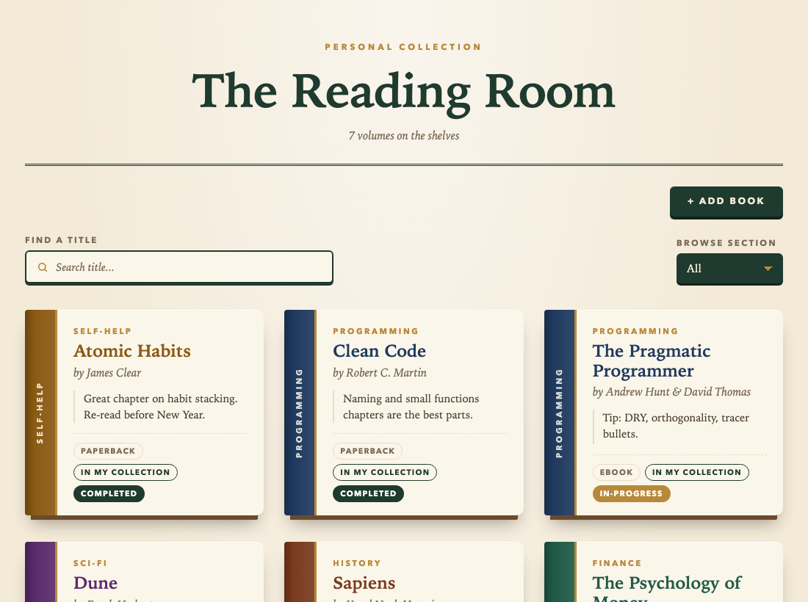

# Day 04: Forms, validation, modal and filters (The Reading Room)

**UI:** a library-style "Reading Room". Books sit on a shelf as cards with spines, and an "Add Book" popup holds a catalogue-card form.

## What I learned
- **One state object for a whole form.** `values` holds every field. A single `handleChange` updates any of them with `[name]: value`.
- **Every input type.**
  - Text, `<select>` and `<textarea>` use `value`.
  - Radio buttons use `checked={values.format === f}`.
  - Checkboxes use `checked` and `e.target.checked`.
- **Validation.** `validate()` returns an `errors` object. If it has any keys, the submit stops. Errors clear as the user edits that field. A regex with the `u` flag checks the author name.
- **Resetting a form.** `setValues(EMPTY_BOOK)` after a successful add.
- **Filtering and searching.** Two filters chained on `books`: category and title search. `visibleBooks` is derived from state and isn't stored.
- **Empty state.** A message shows when nothing matches.
- **Modal popup.** `isFormOpen` state decides whether the modal renders.
  - Close it with the × button, an Escape key press, or a click on the backdrop.
  - The backdrop check `e.target === e.currentTarget` makes sure clicks inside the card don't close it.
- **`useEffect` with cleanup.** The Escape key listener is added only while the modal is open, and the returned function removes it.
- **Importing JSON.** The starting data comes from `assets/data.json`.
- **`data-*` attributes.** `data-category` and `data-status` let CSS style cards without extra class names.
