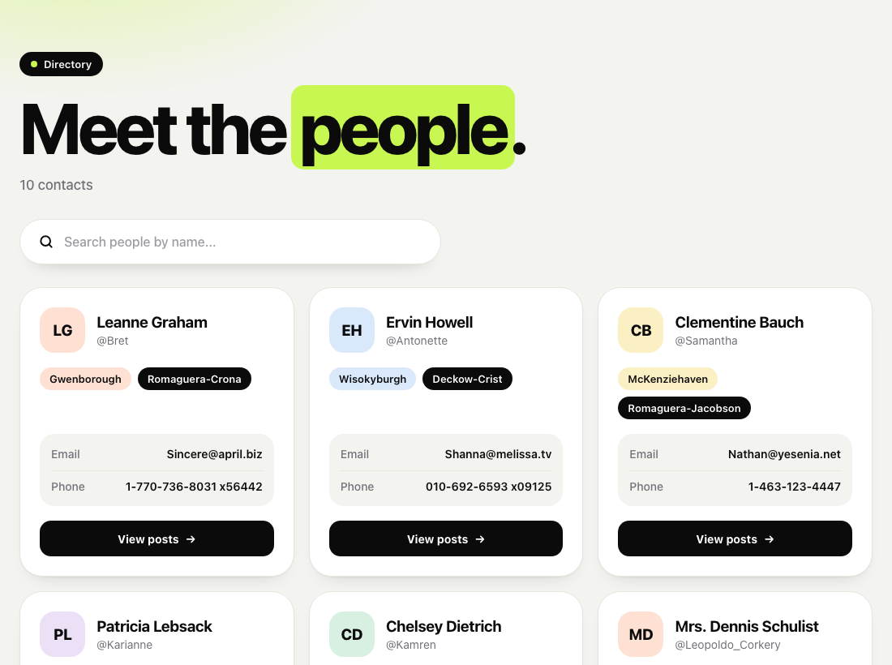

# Day 05 practice: Users, posts and comments

**UI:** a clean, modern people directory with a light page, big tight type, white rounded cards and a lime highlight. Pick a user to see their posts, and pick a post to see its comments.

Data comes from the free [JSONPlaceholder](https://jsonplaceholder.typicode.com) API:

| Screen | Endpoint |
|---|---|
| Users list | `/users` |
| One user's posts | `/posts?userId=<id>` |
| One post's comments | `/comments?postId=<id>` |

## What I learned

### Fetching data
- **Fetch inside `useEffect`.** The effect callback can't be `async`, so I define an async function inside it and call it. The `[]` dependency array makes it run once after the first render.
- **`await response.json()`.** Without `await`, `setUsers` stores a Promise and `users.map` crashes.
- **`fetch` doesn't throw on HTTP errors.** I check `response.ok` and throw my own error.
- **`AbortController` cleanup.** The effect returns `() => controller.abort()`. An `AbortError` is ignored in the `catch`, and the `finally` block only sets `loading` to `false` when the request wasn't aborted. That matters in StrictMode, where effects run twice in development.
- **Three states, three early returns.** `loading`, `errors` and "no data" are each an early `return`, before the main UI.

### Retry with a limit
- `retryCount` is state, and it sits in the effect's dependency array. Clicking Retry changes it, so the effect runs again.
- `MAX_RETRIES` is a constant. When `retryCount >= MAX_RETRIES` the UI shows "Retry limit exceeded" and the button is disabled. A button that silently does nothing is a bug.

### Component design
- **Lifting state up.** `App` owns `selectedUser`. `UsersList` gets `onSelectUser` and `onClearUser` as props.
- **One component, one fetch.** `UsersList`, `UserPosts` and `PostComments` each load their own data, with their own loading, error and empty states.
- **Refetching on a new id.** `UserPosts` depends on `[user.id]` and `PostComments` on `[post.id]`, so choosing another item loads fresh data.
- **Prop names must match.** `App` passed `selectedUser=` but `UserPosts` read `user`, which crashed on `user.id`.
- **Local state for a local choice.** `selectedPost` lives inside `UserPosts`. Going back to the posts list doesn't refetch, because the component stays mounted.

### Searching and debouncing
- **Derived state.** The filtered list is calculated on each render from `users` and the query. It isn't stored in state.
- **Partial, case-insensitive search.** `name.toLowerCase().includes(query.toLowerCase())`. An exact match (`===`) showed nothing for an empty query.
- **Debounce with two states.**
  - `userQuery` updates on every keystroke and drives the input.
  - `debouncedQuery` updates 500 ms after the last keystroke and drives the filter.
  - A `setTimeout` inside `useEffect`, with `clearTimeout` as the cleanup, restarts the timer on every keystroke.
- **The dependency array matters.** The effect needs `[userQuery]`. Without it, it runs after every render.

### HTML and CSS bits
- **Don't put a card inside a `<button>`.** Block elements like headings aren't valid inside a button. A real "View posts" button inside the card, stretched with `::after { position: absolute; inset: 0 }`, makes the whole card clickable.
- **`data-tone={user.id % 5}`** lets CSS pick one of five colours without extra class logic.
- **`dl` / `dt` / `dd`** for label and value pairs like Email and Phone.
- **Accessibility.** `aria-label` on the search input, `aria-hidden` on decorative icons, and `:focus-visible` outlines.
