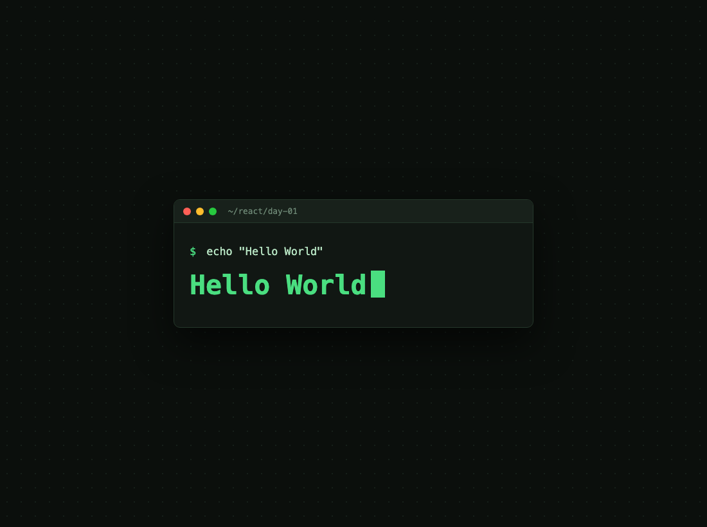
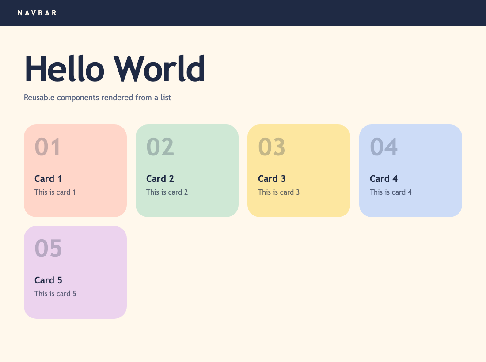
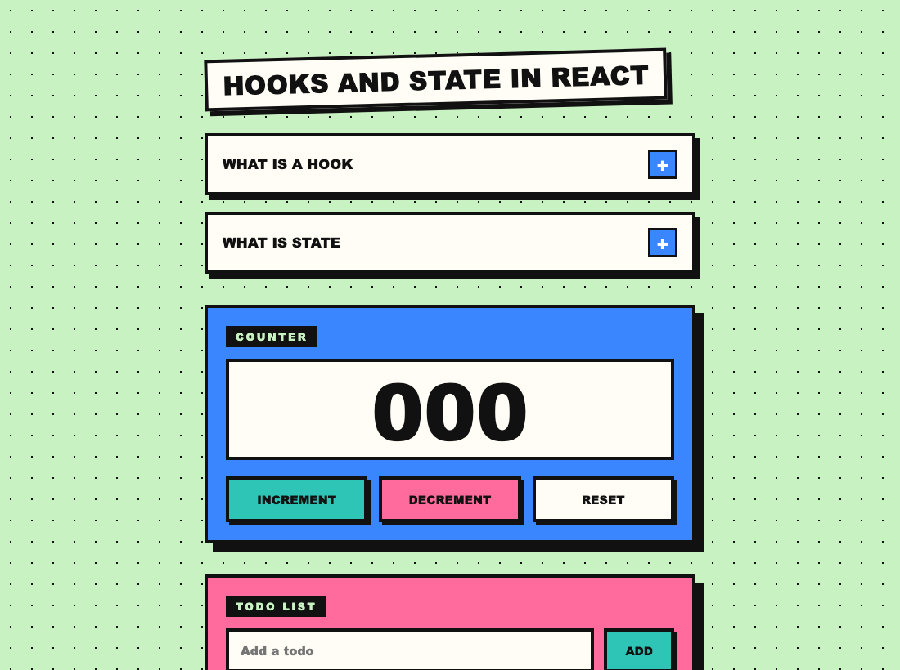
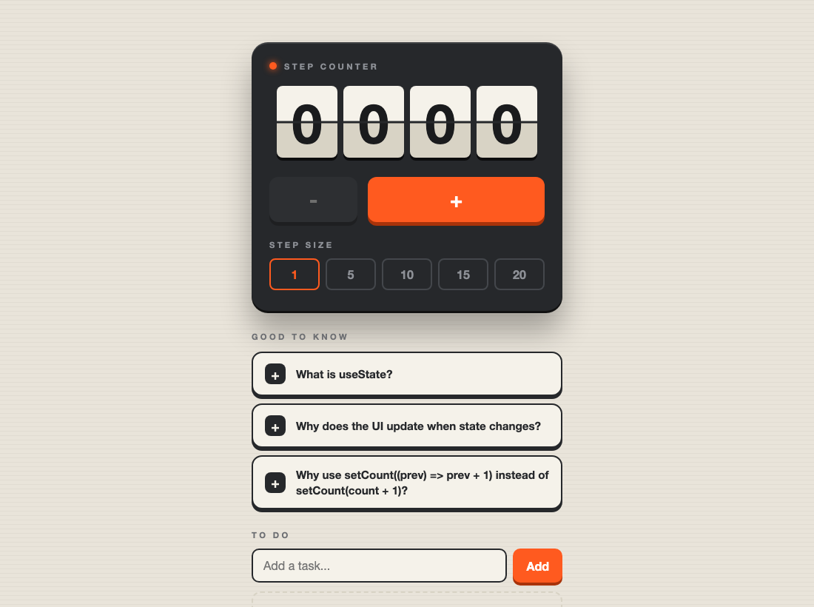
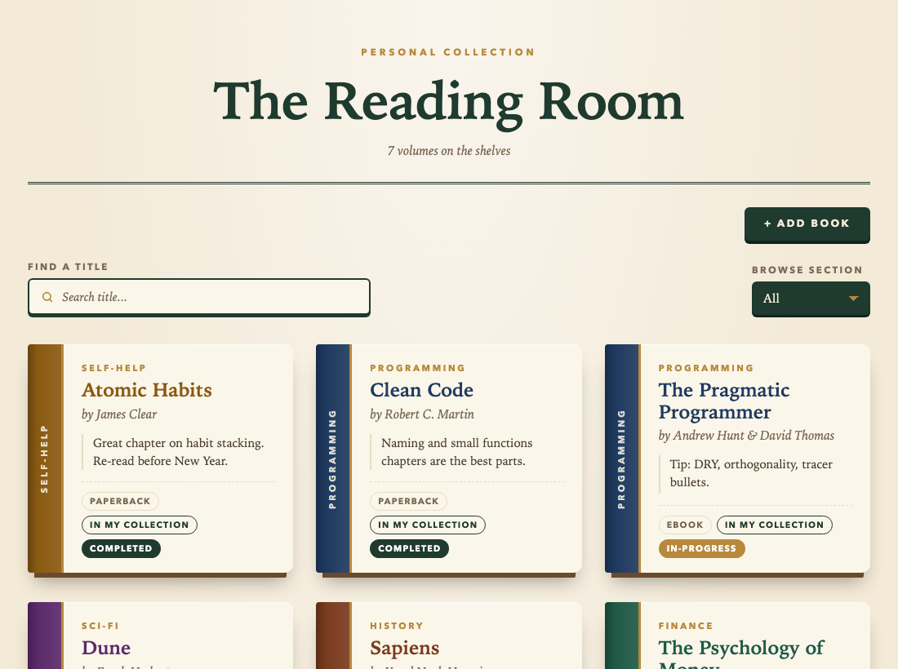
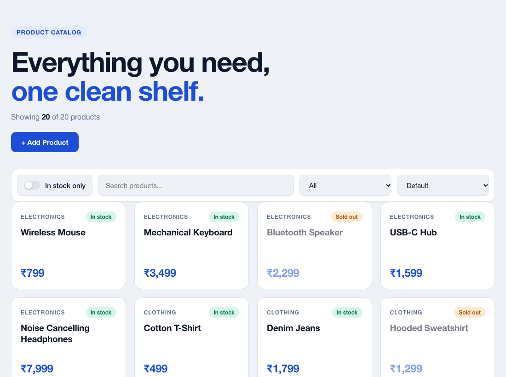
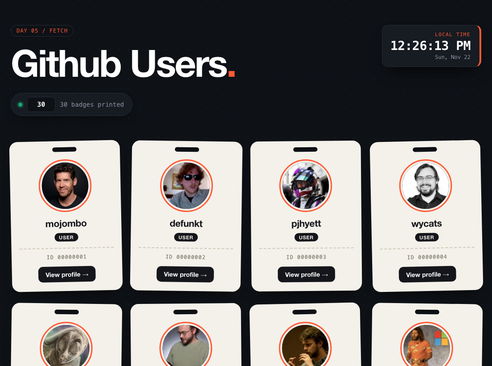
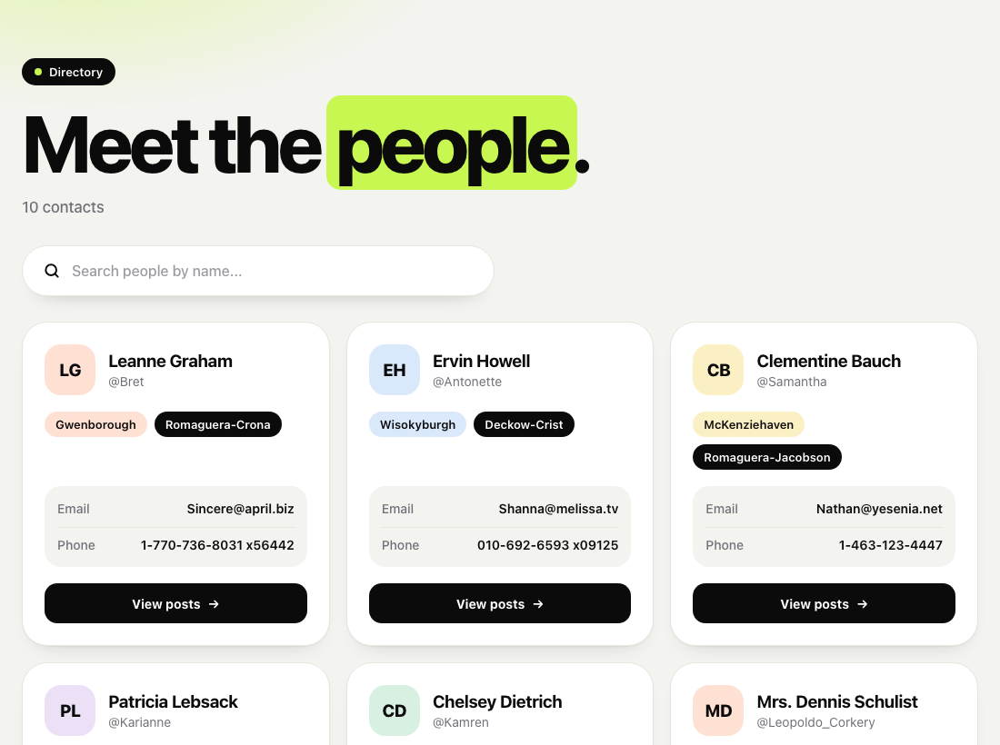

# React Learnings

My day-by-day React journal. Each day is its own small Vite + React project with its own `package.json`, code, screenshot and notes. Every day also gets a different look, so the UIs don't blend together.

## Days at a glance

| Day | Topic | Screenshot |
|---|---|---|
| [Day 01](./Day-01) | Hello World: Vite setup, components, JSX | <a href="./Day-01"></a> |
| [Day 02](./Day-02) | Components, props, `children`, lists and `key` | <a href="./Day-02"></a> |
| [Day 03](./Day-03) | `useState`: counter, toggle, todo app | <a href="./Day-03"></a> |
| [Day 03 practice](./Day-03-practice) | Step counter, FAQ accordion, todo with clear-completed | <a href="./Day-03-practice"></a> |
| [Day 04](./Day-04) | Forms, validation, modal, search and filter (library) | <a href="./Day-04"></a> |
| [Day 04 practice](./Day-04-practice) | Product catalog: sort, filter, add-product modal | <a href="./Day-04-practice"></a> |
| [Day 05](./Day-05) | `useEffect`: GitHub users fetch and a live clock | <a href="./Day-05"></a> |
| [Day 05 practice](./Day-05-practic3e) | Users, posts and comments: fetch states, retry, debounce | <a href="./Day-05-practic3e"></a> |

## How the concepts build on each other

1. **Day 01: the basics.** A component is a function that returns JSX, and `createRoot` mounts it.
2. **Day 02: props.** Data flows down from parent to child, and lists are rendered with `.map()` and a stable `key`.
3. **Day 03: state.** `useState` and immutable updates (`map`, `filter`, spread). Controlled inputs, lifting state up, and derived values like "2 of 4 done".
4. **Day 04: forms and filtering.** One state object for a whole form, validation, filters, search, sorting without mutating state, and a modal with an Escape key listener.
5. **Day 05: side effects.**
   - `useEffect` with a dependency array, async fetching, and cleanup (`AbortController`, `clearTimeout`, `clearInterval`).
   - Loading, error and empty states, a retry with a limit, and a debounced search.
   - Master-detail views: user, then posts, then comments.

## Running a project

Every day is independent:

```bash
cd Day-05-practic3e      # or any other Day-XX folder
npm install
npm run dev
```

Then open the local URL Vite prints (usually http://localhost:5173).

## Folder layout

```
React/
├── Day-01/ … Day-05-practic3e/
│   ├── src/
│   │   ├── App.jsx
│   │   ├── Components/
│   │   └── index.css
│   ├── screenshot.png      what the UI looks like
│   ├── README.md           what I learned that day
│   └── package.json
└── README.md               this file
```

## Notes

- Day 05 uses the GitHub public API. It is limited to about 60 requests per hour per IP address, so too many reloads can make the fetch fail.
- Day 05 practice uses [JSONPlaceholder](https://jsonplaceholder.typicode.com), a free fake API for testing.
